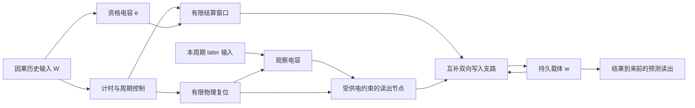

# MFS0-E1 下一阶段方案：器件设计与映射资格

日期：2026-09-29。状态：待实施的研究方案；本次交付不修改项目，不启动实验。

**只读边界：** `C:/Users/shaoc/AppData/Roaming/warp/Warp/data/worktrees/cell-cc/mesquite-gecko` 仅作源码与历史证据参考。禁止在其中写源码、字节码缓存、实验数据、账本、报告或 BACKLOG。未来实现与试验也应在独立工作副本进行，原目录保持只读。

本文件是下一阶段的主要方案。此前关于 E0 收口和统计反例的文档继续作为背景，不再重复开启 E0 物理实验。

## 1. 本阶段要取得什么

E0 的当前结论是 `A_CONDITIONAL + HOLD_EXPOSURE`：在限定参考输入下，已经有能保存历史影响并改变未来响应的载体候选。

E1 的最终问题是：同一个载体能否随新经验修正预测，并在关系反转后恢复适应？

**眼下这一阶段先解决其前提：能否用明确、因果、有供电来源的器件结构，形成有界、可反向、增益可解释的更新。**

阶段结束的主要交付是器件设计单与小范围映射结果，不是一个新的“学习已解决”标签。DA、CPC、多历史信用分配、结构生长暂不并入这一阶段。

## 2. 保留的目标方程

令 z=1−w，参考目标为：

\[
\dot z=\eta a(t)[y(1-z)-(1-y)z]=\eta a(t)(y-z),
\qquad z\in[0,1].
\]

y 是本次观察周期内事件是否发生的结果；a 是非负资格及结算门。两种结果使用同一结算时刻和资格规则。对结果在写入期间保持不变的理想情况：

\[
z_{n+1}=(1-\alpha_n)z_n+\alpha_n y_n,
\quad\alpha_n=1-\exp[-\eta A_n],\quad A_n=\int a(t)dt.
\]

这提供参考解，不是可以直接写进器件主循环的“语义更新捷径”。器件实现必须交代资格、结果门、状态因子、写电流和电源来自哪里。

学习率不要求生物学唯一决定。可以先规定希望用多少次经验适应，再推导 η 与资格面积的关系；设计目标、既有参数和实测器件量分别标注。α=0.05 继续仅作数学算例，不自动成为新轮冻结参数。

## 3. 结构分工与状态表

这是功能连接图，不等于已经完成晶体管连接与节点方程。

| 状态 | 候选载体 | 用途 | 下一次经验如何处理 |
|---|---|---|---|
| e | 资格电容及泄漏路径 | 记录历史输入的可写资格 | 自然衰减；必要时以已定义物理路径复位 |
| V_o | 观察电容 | 在有限窗口内记录 later 的发生 | 有限导电放电，不直接设零 |
| V_T | RC 计时状态 | 决定观察结束与结算开始 | 物理复位并记录残留 |
| V_sense | 读出节点电容 | 把观察状态转为受限的写入门控 | 通过负载或明确的复位支路清除 |
| w | Memristor 持久状态 | 保存可修正预测所需的状态 | 跨经验、跨阶段保持，禁止重建 |
| 其他脉冲/复位状态 | 由具体设计决定 | 形成有限结算脉冲、避免重复触发 | 必须列入完整状态表 |

新增神经元间通路需要明确 Sources→SynapticBundle→Targets；细胞内电容、泄漏及通道状态应按其真实角色建模，不为形式统一而强加突触。现有 entry_gate/history_kernel 已有这种区分，但它们的历史资格不能自动转移到新结构。

## 4. 输入先解决因果性

第一版采用 **CAUSAL_REPLAY_REFERENCE + TEMPLATE_TRANSLATION**：外部生成器可以事先生成整条输入，但学习器每一步只接收已经到达的输入。

学习器不可访问阶段编号、生成概率、实验结果标签、样本名或未来 t_rearm。旧适配器 `(t−t_up)/(t_rearm−t_up)` 不可直接使用。

首先定义 W 的当前可见起始/支撑信号，以及 later 的当前发生输入；不要把 Hτ 的残余电压直接当成本周期的新事件。若仍使用历史核辅助换能，必须给出其尾迹不能误置位的间隔或隔离条件。

输入、窗口和支路均不依赖素材文件名。先限制为一个观察周期在运行，避免同时引入多个历史的结果归属问题。

**因果门：**两条输入流在 t 以前相同、未来不同，则其内部状态与预测在 t 以前必须相同。

## 5. 优先突破：允许近似二值，但给出明确误差界

不要求观察电容永久保持一个精确电压。要求的是：结算时的有效结果信号足够接近本次 y，并且误差可以界定。

仅设置电容上限不够：事件后 V_o 会泄漏，同样的“发生过”可能得到不同门控电流。第一候选是**受限电源驱动的读出节点**，利用负载线形成接近平台的输出，而不是将电容钳位误认为恒定输出。

### 5.1 候选节点方程

观察电压控制导电支路：

\[
G(V_o)=g_c(V_o-\theta_o)_+.
\]

电源 V_D 经内阻 R_S 和该导电支路，驱动带负载 R_L、节点电容 C_s 的读出节点 v。其节点方程可写成：

\[
C_s\dot v={V_D-v\over R_S+1/G}-{v\over R_L}.
\]

G=0 时供电支路开路，只保留负载泄漏。G 的单位必须是西门子，不能把返回电流的 `MOSFET.conduct()` 原样当电导。项目 RailLatch 曾用明确参考电压完成这类单位转换，可作建模先例，但不能自动继承其资格。

定常解为：

\[
v_\infty=V_D{GR_L\over1+G(R_S+R_L)}.
\]

令 V_H=V_D R_L/(R_S+R_L)，归一化的定常结果信号为：

\[
s_\infty={v_\infty\over V_H}
={G(R_S+R_L)\over1+G(R_S+R_L)}.
\]

这说明平台来自供电与负载的共同限制。对所有有效事件，若 G≥G_min，要使定常误差不超过 δ_plateau，应满足：

\[
\boxed{G_{min}(R_S+R_L)\ge{1-\delta_{plateau}\over\delta_{plateau}}.}
\]

例如 δ_plateau=0.01 要求左侧至少 99。这是揭示器件代价的算例，不是要求执行者直接填入某组大增益。

### 5.2 平台与复位存在可计算的冲突

无事件时，读出节点经 R_L 释放，时间常数为 R_L C_s。若上次残留最高 v_prev，需要在 T_clear 内降到 v_off,max，则：

\[
R_L\le {T_{clear}\over C_s\ln(v_{prev}/v_{off,max})}.
\]

平台要求又给出下界：

\[
R_L\ge {1-\delta_{plateau}\over\delta_{plateau}G_{min}}-R_S.
\]

**这两个界限必须相容。** 增大负载电阻虽有利于平台，却会延缓清除，不能只挑有利的一项。

若可行域为空，候选结构需要明确改变：增加独立的有限复位支路、调整节点电容、改变观察保持/读出方式，或更改任务时序。每种变化都带来元件与供电代价，另列设计版本；不得只反复调参直到某次输出通过。

### 5.3 有限建立时间不能忽略

定常公式不保证结算开始时已经达到平台。对固定 G：

\[
\tau_s=C_s\big[(R_S+1/G)\parallel R_L\big].
\]

必须为最晚有效事件保留检测与建立时间，或从时变节点方程给出整个写入窗口的误差界。最早事件决定保持难度，最晚事件决定建立难度；两端都需检查。

V_H 的参考生成、电源余量、负载与门控连接是设计单必填项。这里的归一化是数学分析，不允许用软件除法读出隐藏状态来冒充已实现的电路。

上述平台推导以固定电源电动势 V_D 和固定参考参数为条件，有限内阻已计入。若结算过程中电源或参考随时间变化，必须重新检查时变节点及 s 的范围，不能沿用静态归一化便宣称仍满足相同误差界。

## 6. 写入支路：补偿偏置，测量实际增益

载体电阻为：

\[
R(w)=r_{min}+(r_{max}-r_{min})z.
\]

若实际定电流读出形成 V_R=I_0R(w)，记：

\[
V_{lo}=I_0r_{min},\quad V_{hi}=I_0r_{max},\quad V_Z=V_{hi}-V_{lo}.
\]

状态因子目标：

\[
u_0=V_R-V_{lo}=V_Zz,\qquad
u_1=V_{hi}-V_R=V_Z(1-z).
\]

若经现有线性阈值 FET，需要的 gate 输入是：

\[
u'_0=u_0+V_{th},\qquad u'_1=u_1+V_{th}.
\]

若用参考电位实现：下参考为 V_lo−V_th，上参考为 V_hi+V_th；不是将两个参考都下移。

两路写电流目标：

\[
J_{dep}=g_da(t)s(t)u_1,\qquad
J_{rec}=g_ra(t)[1-s(t)]u_0.
\]

κ_m(J_dep−J_rec) 决定 z 的变化。实际设计必须说明 s、1−s 的互补门如何由物理节点提供，两支路如何供电，以及 a 与它们如何合成；上式不自动授予自洽模拟乘法资格。

两路匹配时得到 \(\dot z=\eta a(t)(s-z)\)。不匹配时，即使共用资格，预测目标仍可能偏移。对固定有效学习率：

\[
z_*={p\alpha_+\over p\alpha_++(1-p)\alpha_-}.
\]

映射检查必须覆盖正向、反向、接近两端、供电变化与事件早晚，而不只是证明两路都有非零电流。

时步明确进入写入积分。原 worktree 中 `Memristor.update` 的 API 不在本阶段修改；独立副本如采用研究包装器，须明确瞬时电流、dt 与积分增量，避免重复乘 dt。

## 7. 为什么近似观察仍可能足够

若实际写入是 \(\dot z=\eta a(t)(s(t)-z)\)，设一次结算窗口为 [t0,t1]，则：

\[
z^+=e^{-\eta A}z^-+
\int_{t_0}^{t_1}\eta a(t)s(t)
e^{-\eta\int_t^{t_1}a(u)du}\,dt.
\]

积分中的非负权重总和为 α=1−e^(−ηA)。因此可以写成：

\[
z^+=(1-\alpha)z^-+\alpha\bar s.
\]

若整个有效写窗内 |s(t)−y|≤δ_obs，则 |bar s−y|≤δ_obs。与相同 α、相同真实 y 的理想参考过程比较：

\[
|d_{n+1}|\le(1-\alpha_n)|d_n|+\alpha_n\delta_{obs}.
\]

从相同初态开始，偏差始终不超过 δ_obs，而不是必然随经验数无界积累。

若每次还有绝对误差 ε_step，且 α_n≥α_min>0，则有保守界：

\[
|d_n|\le\max\{|d_0|,\delta_{obs}+\varepsilon_{step}/\alpha_{min}\}.
\]

这给出了设计判据：**允许内部电压变化，但限制它对预测功能造成的偏差。** 因而无需为追求精确的二值内部状态而过早引入复杂永久锁存结构。

保证有前提：两路匹配、状态有界、误差在全窗口内受控、参考与器件采用相同资格规则。若 α 因结果、共享电源或旧 z 而发生未建模变化，不能直接套用该界限。

## 8. 观察、时钟和资格共同决定时间可行域

至少同时满足：

\[
T_{source,max}+L_{trans,max}+T_{sense,settle}+T_{margin}<T_{obs},
\]

\[
T_{obs}+T_{write}<T_{e,reachable},
\]

\[
V_{set,min}e^{-T_{hold,max}/\tau_o}\ge V_{o,min},
\]

以及观察电容、读出节点、计时器的复位残留界。

V_o,min 由第 5 节的 G_min 要求反推，不仅仅要求 V_o 高于阈值。

RC 计时参考式：

\[
T_c=\tau_T\ln{V_\infty-V_0\over V_\infty-V_{\theta,T}}.
\]

结算脉冲的开始、结束与复位均要落实到结构。不能只展示一个越阈时刻，却在代码中用 `if t == t_c` 完成内部决策。

改用因果驱动后，必须重新形成 e 的波形和可写窗口；旧 718 步余量、0.72 s 尾迹都不是可直接沿用的新轮常数。

## 9. 分三步推进，逐步交付

### D0：器件设计与可行域

交付：完整状态表、逐节点连接图、节点/写入方程、单位表、参数来源、供电与泄漏清单，以及上述不等式是否有共同解。

每个新组件写清：对应的物理或生物过程、采用的结构、参数为何如此。当前节点模型首先是 SEMI 候选；不能把有限电容记录的类比扩写成已经证实的生物学习机制。

通过条件：不存在隐藏结果标签、未来输入或内部软件时钟；存在有来源且相容的参数范围；新增不可复用元件已明确列出。若可行域为空，交付原因与最小结构修订，不开展长程试验。

### D1：独立副本中的小范围映射

只在新建工作副本中实施。固定目标和误差预算后，覆盖以下条件：

| 检查 | 要排除的问题 |
|---|---|
| 相同前缀、不同未来 | 使用未来时刻或标签 |
| 无事件，以及上周期有事件而本周期无事件 | 旧尾迹误置位、复位残留 |
| 最早/最晚有效事件、重复事件 | 保持不足、建立不足、事件数改变增益 |
| 相同资格下正向/反向写入 | α+、α− 不匹配 |
| z 接近 0/1 与区间内部 | 死区、吸收边界、依赖 clamp 掩盖错误 |
| 三档 dt、同一物理时长 | 时间单位或积分错误 |
| 供电边界、断开关键支路、零资格 | 隐藏供能、旁路写入 |
| 跨周期连续推进 | 重建对象、软件清零或预测回填 |

报告实际 α、δ_obs、ε_map、支路失配、复位残留，以及墙钟成本。参考模型与器件采用同一因果输入，并区分“预测目标误差”与“数值积分误差”。

这一步完成后才确定正式流数、时长和预算。调用次数、预算集合、内部子仿真分别记录；失败尝试也记录。缺少次数时使用 UNKNOWN，不按零求和。

### D2：封存后的连续预测检验

D1 通过后，采用同一载体经历 0.8→0.2→0.8 的关系变化，预测必须在本次结果到来前输出，跨阶段不重置 w。

主输出：逐次器件/参考轨迹误差、逐阶段 Brier 损失、反转与恢复曲线。统计界限使用实际 α 和有限窗口相关性；无写入与单向写入保留为明确基线。同频独立反馈只作阴性参照，删除“必须优于错配 10%”门。

物理断写等关键干预仍需实际执行；数学基线不能替代接线核查。流、种子、阈值、依赖与运行预算在正式评估前封存，公开所有中止和失败条件。

通过也只授予限定范围的可修正频率预测载体资格。多历史选择和动作信用，需要下一阶段引入可物理区分的历史与相应任务。

## 10. 现在应开始的具体工作

当前启动范围是 **D0 器件设计与可行域**。优先完成两张图和一张表：

1. 观察电容→受供电约束读出→互补门的节点图，包含复位与负载。
2. 持久载体→双参考→双向写入的节点图，包含资格和结算控制。
3. 全部约束的可行域表：保持、建立、清除、资格、时钟、供电、两路增益及误差。

后续核心决策依据是这些结构能否共同满足方程，而不是先扩大网络、增加模块名或直接跑数百次经验。原 worktree 在本阶段及其后续实现中持续保持只读。
